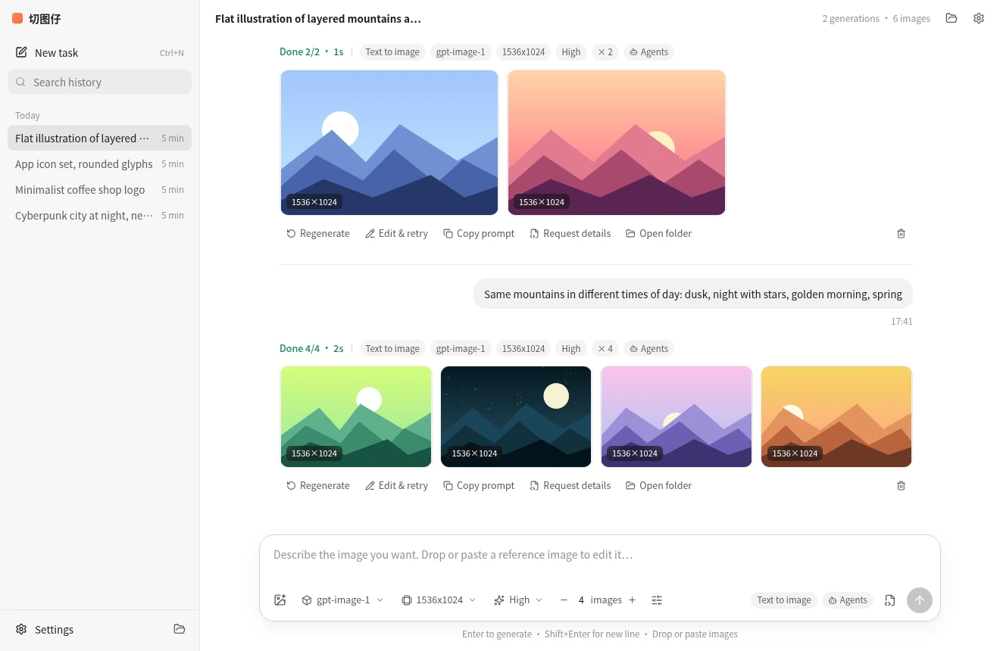

<p align="center"></p>

<h1 align="center">切图仔 · Qietuzai</h1>

<p align="center">A desktop app for OpenAI-compatible image generation APIs. Type a prompt, get images.<br>It includes <code>img.sh</code>, the command-line script the app grew out of.</p>

<p align="center">
  <b>English</b> ·
  <a href="docs/README.zh-CN.md">简体中文</a> ·
  <a href="docs/README.zh-TW.md">繁體中文</a> ·
  <a href="docs/README.ja.md">日本語</a> ·
  <a href="docs/README.ko.md">한국어</a> ·
  <a href="docs/README.es.md">Español</a> ·
  <a href="docs/README.fr.md">Français</a> ·
  <a href="docs/README.de.md">Deutsch</a> ·
  <a href="docs/README.pt-BR.md">Português</a> ·
  <a href="docs/README.ru.md">Русский</a>
</p>

<p align="center"></p>

## Features

- **Codex-style layout.** History is on the left and the workspace on the right. Each generation shows its prompt, reference images and results together.
- **No chat.** Press Enter and the prompt goes straight to the image API.
- **Text to image and image to image.** Drop, paste or pick reference images. With two or more, you can mark one as the mask.
- **Batches.** Generate 1–20 images per prompt, or turn on one-prompt-per-line. All tasks share one concurrency limit.
- **Switch model, size and quality** for each request. Custom values are allowed.
- **Agents prompt.** Text added to the start of every request, such as a style guide, brand rules or things to avoid.
- **Size check.** Every image shows its real size. The app warns you when the API ignored the size you asked for, and can also write the size into the prompt.
- **Dry run.** Preview the exact request before sending it (in batch mode, the request for the first prompt). The API key is masked.
- **Work with results.** View them full size, copy them, show them in their folder, save a copy, drag them into Figma or Photoshop, or use one as a reference image.
- **10 languages:** 简体中文, 繁體中文, English, 日本語, 한국어, Español, Français, Deutsch, Português, Русский. The app follows your system language by default.
- **API key is stored on your computer** and sent only to the API you configure. It is encrypted with the system keychain when one is available. Without a usable keychain (for example on some Linux desktops) it is only lightly encrypted or kept in plain text, in a settings file only you can read. The API key field in Settings shows which applies. A proxy is optional.

## Download

Get the latest version from [Releases](https://github.com/jerry1zhang/qietuzai/releases/latest):

| System | File |
| --- | --- |
| macOS, Apple Silicon (M1 and later) | `qietuzai-<version>-mac-arm64.dmg` |
| macOS, Intel | `qietuzai-<version>-mac-x64.dmg` |
| Windows installer | `qietuzai-<version>-win-x64.exe` (ARM: `win-arm64.exe`) |
| Windows portable | `qietuzai-<version>-portable.exe` |
| Linux | `qietuzai-<version>-linux-x86_64.AppImage` or `-linux-amd64.deb` |

The app is not signed by Apple or Microsoft, so the system warns you the first time you open it:

- **macOS 15 and later:** open the app once, then go to System Settings → Privacy & Security and click "Open Anyway" at the bottom.
- **macOS 14 and earlier:** right-click the app and choose Open.
- On macOS you can also run `xattr -dr com.apple.quarantine /Applications/切图仔.app` in Terminal.
- **Windows:** if SmartScreen appears, click "More info", then "Run anyway".

## Getting started

1. Open **Settings**. Enter the API URL (for example `https://api.openai.com/v1`) and your API key, then click **Test connection**.
2. Add the models you use, or click **Fetch from API** and pick them from the list. The starred model is the default. Then click **Save** in the bar at the bottom.
3. Go back to the workspace, type a prompt and press Enter.

Any service compatible with the OpenAI Images API works (`/v1/images/generations` and `/v1/images/edits`). If you already use `img.sh`, click **Import img.config** to fill in the settings.

## FAQ

**Changing the size or quality has no effect.**
Some relay services ignore the `size` and `quality` parameters, for example services that route requests through ChatGPT or Codex accounts. 切图仔 shows the real size of every image and marks the ones that don't match. You can turn on **Settings → Write size into prompt**, which adds a sentence like "Output image size: 1536x1024 (landscape, 3:2)." to the prompt. Models usually follow it only roughly, so crop or resize locally if you need an exact size.

**Where are my images saved?**
By default in `Pictures/切图仔`. You can change this in Settings → Output. Settings and history are kept in the data folder shown under Settings → About.

## Command line: img.sh

`img.sh` is the original script. It needs bash, curl and jq, so it runs on macOS and Linux. Put an `img.config` next to it:

```ini
url=https://api.openai.com/v1
token=sk-...
# optional
model=gpt-image-1
size=1024x1024
quality=high
count=1
```

```bash
./img.sh "a red fox in the snow"                     # 1 image, saved to outputs/
./img.sh -n 4 "a red fox in the snow" fox.png        # fox-1.png … fox-4.png
./img.sh -i photo.png "replace the background with a beach"
./img.sh -i a.png -i b.png "combine the two images"
./img.sh -i photo.png -m mask.png "fill the masked area with stars"
./img.sh --dry-run "a red fox"                       # print the request without sending it
```

These environment variables override the config: `IMG_MODEL`, `IMG_SIZE`, `IMG_JOBS` (concurrency) and `IMG_CONFIG` (path to the config file). An existing file is never overwritten; the new one is saved as `name (2).png`. Run `./img.sh --help` for all options (the help text is in Chinese).

## Building from source

```bash
cd gui
npm install
npm run dev          # development mode with hot reload
npm test             # unit tests
npm run dist:mac     # or dist:win / dist:linux, run on that system
```

Each installer has to be built on its own system. Pushing a `v*` tag makes GitHub Actions (`.github/workflows/build.yml`) build all three. See [gui/README.md](gui/README.md) for more details (in Chinese).

The UI text lives in `gui/shared/locales/`, one file per language. To fix a translation, edit that file. `npm test` checks that every language has every key and placeholder.
