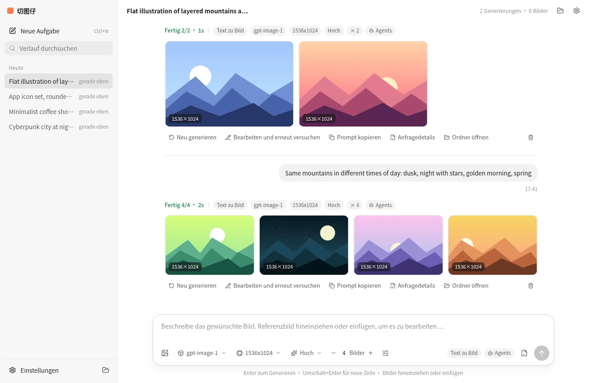

<p align="center"></p>

<h1 align="center">切图仔 · Qietuzai</h1>

<p align="center">Eine Desktop-App für OpenAI-kompatible Bildgenerierungs-APIs: Prompt eingeben, Bilder erhalten.<br>Dabei ist auch <code>img.sh</code>, das Kommandozeilen-Skript, aus dem die App entstanden ist.</p>

<p align="center">
  <a href="../README.md">English</a> ·
  <a href="README.zh-CN.md">简体中文</a> ·
  <a href="README.zh-TW.md">繁體中文</a> ·
  <a href="README.ja.md">日本語</a> ·
  <a href="README.ko.md">한국어</a> ·
  <a href="README.es.md">Español</a> ·
  <a href="README.fr.md">Français</a> ·
  <b>Deutsch</b> ·
  <a href="README.pt-BR.md">Português</a> ·
  <a href="README.ru.md">Русский</a>
</p>

<p align="center"></p>

## Funktionen

- **Aufbau wie bei Codex.** Links ist der Verlauf, rechts der Arbeitsbereich. Jede Generierung zeigt Prompt, Referenzbilder und Ergebnisse zusammen.
- **Kein Chat.** Mit Enter geht der Prompt direkt an die Bild-API.
- **Text zu Bild und Bild zu Bild.** Referenzbilder hineinziehen, einfügen oder auswählen. Ab zwei Bildern lässt sich eines als Maske festlegen.
- **Stapel.** 1–20 Bilder pro Prompt erzeugen oder einen Prompt pro Zeile verwenden. Alle Aufgaben teilen sich ein gemeinsames Limit für parallele Anfragen.
- **Modell, Größe und Qualität** lassen sich bei jeder Anfrage wechseln, auch eigene Werte sind möglich.
- **Agents-Prompt.** Text, der jedem Prompt vorangestellt wird, etwa ein einheitlicher Stil, Markenrichtlinien oder Verbote.
- **Größenprüfung.** Jedes Bild zeigt seine tatsächliche Größe. Die App warnt, wenn die API die gewünschte Größe ignoriert hat, und kann die Größe auch in den Prompt schreiben.
- **Probelauf.** Die genaue Anfrage vor dem Senden ansehen (im Stapelmodus die des ersten Prompts). Der API-Schlüssel wird maskiert.
- **Mit den Ergebnissen arbeiten.** Bilder groß ansehen, kopieren, im Ordner anzeigen, als Kopie speichern, direkt in Figma oder Photoshop ziehen oder als Referenzbild weiterverwenden.
- **10 Sprachen:** 简体中文, 繁體中文, English, 日本語, 한국어, Español, Français, Deutsch, Português, Русский. Standardmäßig folgt die App der Systemsprache.
- **Der API-Schlüssel wird auf deinem Computer gespeichert** und nur an die eingestellte API gesendet. Er wird mit dem Schlüsselbund des Systems verschlüsselt, sofern einer verfügbar ist. Ohne nutzbaren Schlüsselbund (etwa auf manchen Linux-Desktops) ist er nur einfach verschlüsselt oder liegt im Klartext in einer Einstellungsdatei, die nur du lesen kannst. Das Feld für den API-Schlüssel in den Einstellungen zeigt, was zutrifft. Ein Proxy ist optional.

## Download

Die neueste Version gibt es unter [Releases](https://github.com/jerry1zhang/qietuzai/releases/latest):

| System | Datei |
| --- | --- |
| macOS, Apple Silicon (M1 und neuer) | `qietuzai-<Version>-mac-arm64.dmg` |
| macOS, Intel | `qietuzai-<Version>-mac-x64.dmg` |
| Windows-Installer | `qietuzai-<Version>-win-x64.exe` (ARM: `win-arm64.exe`) |
| Windows portabel | `qietuzai-<Version>-portable.exe` |
| Linux | `qietuzai-<Version>-linux-x86_64.AppImage` oder `-linux-amd64.deb` |

Die App ist weder von Apple noch von Microsoft signiert, daher warnt das System beim ersten Öffnen:

- **macOS 15 und neuer:** Die App einmal öffnen, dann unter Systemeinstellungen → Datenschutz & Sicherheit unten auf „Dennoch öffnen“ klicken.
- **macOS 14 und älter:** Mit der rechten Maustaste auf die App klicken und „Öffnen“ wählen.
- Unter macOS geht auch `xattr -dr com.apple.quarantine /Applications/切图仔.app` im Terminal.
- **Windows:** Wenn SmartScreen erscheint, auf „Weitere Informationen“ und dann auf „Trotzdem ausführen“ klicken.

## Erste Schritte

1. **Einstellungen** öffnen. API-URL (zum Beispiel `https://api.openai.com/v1`) und API-Schlüssel eintragen und auf **Verbindung testen** klicken.
2. Die gewünschten Modelle hinzufügen oder auf **Von der API abrufen** klicken und sie aus der Liste wählen. Das markierte Modell ist der Standard. Danach unten in der Leiste auf **Speichern** klicken.
3. Zurück im Arbeitsbereich einen Prompt eingeben und Enter drücken.

Jeder Dienst, der zur OpenAI Images API kompatibel ist, funktioniert (`/v1/images/generations` und `/v1/images/edits`). Wer schon `img.sh` nutzt, kann mit **img.config importieren** die Einstellungen übernehmen.

## Häufige Fragen

**Größe oder Qualität zu ändern hat keine Wirkung.**
Manche Relay-Dienste ignorieren die Parameter `size` und `quality`, zum Beispiel Dienste, die Anfragen über ChatGPT- oder Codex-Konten leiten. 切图仔 zeigt bei jedem Bild die tatsächliche Größe an und markiert Abweichungen. Unter **Einstellungen → Größe in den Prompt schreiben** lässt sich ein Satz wie „Größe des Ausgabebilds: 1536x1024 (Querformat, 3:2).“ an den Prompt anhängen. Modelle halten sich meist nur ungefähr daran; für exakte Größen das Bild lokal zuschneiden oder skalieren.

**Wo werden die Bilder gespeichert?**
Standardmäßig im Ordner `切图仔` in deinem Bilder-Ordner. Das lässt sich unter Einstellungen → Ausgabe ändern. Einstellungen und Verlauf liegen im Datenordner, der unter Einstellungen → Über angezeigt wird.

## Kommandozeile: img.sh

`img.sh` ist das ursprüngliche Skript. Es braucht bash, curl und jq und läuft daher unter macOS und Linux. Lege daneben eine `img.config` an:

```ini
url=https://api.openai.com/v1
token=sk-...
# optional
model=gpt-image-1
size=1024x1024
quality=high
count=1
```

```bash
./img.sh "ein roter Fuchs im Schnee"                 # 1 Bild, gespeichert in outputs/
./img.sh -n 4 "ein roter Fuchs im Schnee" fox.png    # fox-1.png … fox-4.png
./img.sh -i foto.png "ersetze den Hintergrund durch einen Strand"
./img.sh -i a.png -i b.png "kombiniere die beiden Bilder"
./img.sh -i foto.png -m maske.png "fülle den maskierten Bereich mit Sternen"
./img.sh --dry-run "ein roter Fuchs"                 # Anfrage nur anzeigen, nicht senden
```

Diese Umgebungsvariablen überschreiben die Konfiguration: `IMG_MODEL`, `IMG_SIZE`, `IMG_JOBS` (parallele Anfragen) und `IMG_CONFIG` (Pfad zur Konfigurationsdatei). Vorhandene Dateien werden nie überschrieben; die neue wird als `Name (2).png` gespeichert. `./img.sh --help` zeigt alle Optionen (der Hilfetext ist auf Chinesisch).

## Aus dem Quellcode bauen

```bash
cd gui
npm install
npm run dev          # Entwicklungsmodus mit Hot Reload
npm test             # Unit-Tests
npm run dist:mac     # oder dist:win / dist:linux, auf dem jeweiligen System
```

Jedes Installationspaket muss auf seinem eigenen System gebaut werden. Ein gepushter `v*`-Tag lässt GitHub Actions (`.github/workflows/build.yml`) alle drei bauen. Weitere Details stehen in [gui/README.md](../gui/README.md) (auf Chinesisch).

Die Texte der Oberfläche liegen in `gui/shared/locales/`, eine Datei pro Sprache. Um eine Übersetzung zu korrigieren, einfach diese Datei bearbeiten. `npm test` prüft, ob jede Sprache alle Schlüssel und Platzhalter hat.
