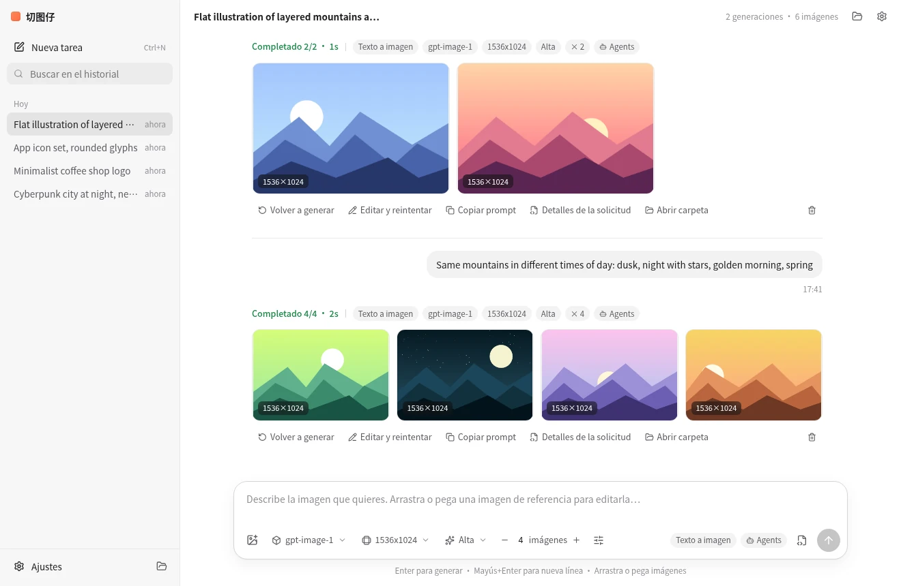

<p align="center"></p>

<h1 align="center">切图仔 · Qietuzai</h1>

<p align="center">Una aplicación de escritorio para API de generación de imágenes compatibles con OpenAI. Escribe un prompt y obtén imágenes.<br>Incluye <code>img.sh</code>, el script de línea de comandos del que nació la aplicación.</p>

<p align="center">
  <a href="../README.md">English</a> ·
  <a href="README.zh-CN.md">简体中文</a> ·
  <a href="README.zh-TW.md">繁體中文</a> ·
  <a href="README.ja.md">日本語</a> ·
  <a href="README.ko.md">한국어</a> ·
  <b>Español</b> ·
  <a href="README.fr.md">Français</a> ·
  <a href="README.de.md">Deutsch</a> ·
  <a href="README.pt-BR.md">Português</a> ·
  <a href="README.ru.md">Русский</a>
</p>

<p align="center"></p>

## Funciones

- **Diseño al estilo de Codex.** El historial está a la izquierda y el área de trabajo a la derecha. Cada generación muestra juntos su prompt, sus imágenes de referencia y sus resultados.
- **No es un chat.** Al pulsar Enter, el prompt va directo a la API de imágenes.
- **Texto a imagen e imagen a imagen.** Arrastra, pega o elige imágenes de referencia. Con dos o más, puedes marcar una como máscara.
- **Lotes.** Genera de 1 a 20 imágenes por prompt, o activa un prompt por línea. Todas las tareas comparten un mismo límite de concurrencia.
- **Cambia de modelo, tamaño y calidad** en cada solicitud. También se admiten valores personalizados.
- **Prompt de Agents.** Texto que se añade al principio de cada solicitud: un estilo común, normas de marca, cosas que evitar…
- **Control del tamaño.** Cada imagen muestra su tamaño real. La aplicación avisa cuando la API ignora el tamaño pedido y también puede escribir el tamaño en el prompt.
- **Dry run.** Revisa la solicitud exacta antes de enviarla (en modo lote, la del primer prompt). La clave de API aparece enmascarada.
- **Trabaja con los resultados.** Puedes verlos a tamaño completo, copiarlos, mostrarlos en su carpeta, guardar una copia, arrastrarlos a Figma o Photoshop, o usar uno como imagen de referencia.
- **10 idiomas:** 简体中文, 繁體中文, English, 日本語, 한국어, Español, Français, Deutsch, Português, Русский. Por defecto sigue el idioma del sistema.
- **La clave de API se guarda en tu equipo** y solo se envía a la API que configures. Se cifra con el llavero del sistema cuando hay uno disponible. Si no lo hay (por ejemplo, en algunos escritorios Linux), solo tiene un cifrado básico o se guarda en texto plano, en un archivo de ajustes que solo tú puedes leer. El campo de la clave en Ajustes indica cuál es el caso. El proxy es opcional.

## Descarga

Descarga la última versión en [Releases](https://github.com/jerry1zhang/qietuzai/releases/latest):

| Sistema | Archivo |
| --- | --- |
| macOS, Apple Silicon (M1 o posterior) | `qietuzai-<versión>-mac-arm64.dmg` |
| macOS, Intel | `qietuzai-<versión>-mac-x64.dmg` |
| Instalador de Windows | `qietuzai-<versión>-win-x64.exe` (ARM: `win-arm64.exe`) |
| Windows portable | `qietuzai-<versión>-portable.exe` |
| Linux | `qietuzai-<versión>-linux-x86_64.AppImage` o `-linux-amd64.deb` |

La aplicación no está firmada por Apple ni por Microsoft, así que el sistema muestra un aviso la primera vez que la abres:

- **macOS 15 o posterior:** abre la aplicación una vez y luego ve a Ajustes del Sistema → Privacidad y seguridad y pulsa «Abrir igualmente» al final de la página.
- **macOS 14 o anterior:** haz clic derecho en la aplicación y elige Abrir.
- En macOS también puedes ejecutar `xattr -dr com.apple.quarantine /Applications/切图仔.app` en Terminal.
- **Windows:** si aparece SmartScreen, pulsa «Más información» y luego «Ejecutar de todas formas».

## Primeros pasos

1. Abre **Ajustes**. Escribe la URL de la API (por ejemplo `https://api.openai.com/v1`) y tu clave de API, y pulsa **Probar conexión**.
2. Añade los modelos que uses, o pulsa **Obtener de la API** y elígelos de la lista. El modelo con estrella es el predeterminado. Después pulsa **Guardar** en la barra inferior.
3. Vuelve al área de trabajo, escribe un prompt y pulsa Enter.

Funciona con cualquier servicio compatible con la OpenAI Images API (`/v1/images/generations` y `/v1/images/edits`). Si ya usas `img.sh`, pulsa **Importar img.config** para rellenar los ajustes.

## Preguntas frecuentes

**Cambiar el tamaño o la calidad no tiene efecto.**
Algunos servicios intermediarios ignoran los parámetros `size` y `quality`, por ejemplo los que enrutan las solicitudes a través de cuentas de ChatGPT o Codex. 切图仔 muestra el tamaño real de cada imagen y marca las que no coinciden. Puedes activar **Ajustes → Escribir el tamaño en el prompt**, que añade al prompt una frase como «Tamaño de la imagen de salida: 1536x1024 (horizontal, 3:2).». Los modelos suelen seguirla solo de forma aproximada, así que recorta o redimensiona en local si necesitas un tamaño exacto.

**¿Dónde se guardan las imágenes?**
Por defecto, en la carpeta `切图仔` dentro de tu carpeta de Imágenes. Puedes cambiarlo en Ajustes → Salida. Los ajustes y el historial se guardan en la carpeta de datos que aparece en Ajustes → Acerca de.

## Línea de comandos: img.sh

`img.sh` es el script original. Necesita bash, curl y jq, así que funciona en macOS y Linux. Pon un `img.config` junto a él:

```ini
url=https://api.openai.com/v1
token=sk-...
# opcional
model=gpt-image-1
size=1024x1024
quality=high
count=1
```

```bash
./img.sh "un zorro rojo en la nieve"                 # 1 imagen, guardada en outputs/
./img.sh -n 4 "un zorro rojo en la nieve" fox.png    # fox-1.png … fox-4.png
./img.sh -i foto.png "cambia el fondo por una playa"
./img.sh -i a.png -i b.png "combina las dos imágenes"
./img.sh -i foto.png -m mascara.png "rellena la zona de la máscara con estrellas"
./img.sh --dry-run "un zorro rojo"                   # muestra la solicitud sin enviarla
```

Estas variables de entorno tienen prioridad sobre la configuración: `IMG_MODEL`, `IMG_SIZE`, `IMG_JOBS` (concurrencia) e `IMG_CONFIG` (ruta del archivo de configuración). Nunca se sobrescribe un archivo existente: el nuevo se guarda como `nombre (2).png`. Ejecuta `./img.sh --help` para ver todas las opciones (la ayuda está en chino).

## Compilar desde el código fuente

```bash
cd gui
npm install
npm run dev          # modo desarrollo con recarga en caliente
npm test             # pruebas unitarias
npm run dist:mac     # o dist:win / dist:linux, en ese sistema
```

Cada instalador debe compilarse en su propio sistema. Al subir una etiqueta `v*`, GitHub Actions (`.github/workflows/build.yml`) compila los tres. Más detalles en [gui/README.md](../gui/README.md) (en chino).

Los textos de la interfaz están en `gui/shared/locales/`, un archivo por idioma. Para corregir una traducción, edita ese archivo. `npm test` comprueba que todos los idiomas tengan todas las claves y marcadores.
