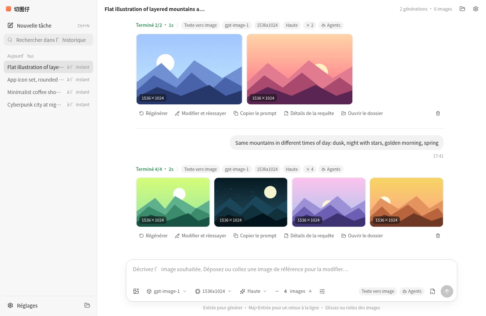

<p align="center"></p>

<h1 align="center">切图仔 · Qietuzai</h1>

<p align="center">Une application de bureau pour les API de génération d’images compatibles OpenAI. Saisissez un prompt, obtenez des images.<br>Elle inclut <code>img.sh</code>, le script en ligne de commande à l’origine de l’application.</p>

<p align="center">
  <a href="../README.md">English</a> ·
  <a href="README.zh-CN.md">简体中文</a> ·
  <a href="README.zh-TW.md">繁體中文</a> ·
  <a href="README.ja.md">日本語</a> ·
  <a href="README.ko.md">한국어</a> ·
  <a href="README.es.md">Español</a> ·
  <b>Français</b> ·
  <a href="README.de.md">Deutsch</a> ·
  <a href="README.pt-BR.md">Português</a> ·
  <a href="README.ru.md">Русский</a>
</p>

<p align="center"></p>

## Fonctionnalités

- **Disposition façon Codex.** L’historique est à gauche, l’espace de travail à droite. Chaque génération affiche ensemble son prompt, ses images de référence et ses résultats.
- **Pas de chat.** Appuyez sur Entrée : le prompt part directement vers l’API d’images.
- **Texte vers image et image vers image.** Déposez, collez ou choisissez des images de référence. À partir de deux, vous pouvez en désigner une comme masque.
- **Lots.** Générez de 1 à 20 images par prompt, ou activez un prompt par ligne. Toutes les tâches partagent une même limite de requêtes simultanées.
- **Changez de modèle, de taille et de qualité** à chaque requête. Les valeurs personnalisées sont acceptées.
- **Prompt Agents.** Un texte ajouté au début de chaque requête : style commun, charte graphique, interdits…
- **Contrôle de la taille.** Chaque image affiche sa taille réelle. L’application vous prévient quand l’API ignore la taille demandée, et peut aussi écrire la taille dans le prompt.
- **Dry run.** Prévisualisez la requête exacte avant de l’envoyer (en mode lot, celle du premier prompt). La clé d’API est masquée.
- **Exploitez les résultats.** Affichez-les en grand, copiez-les, montrez-les dans leur dossier, enregistrez une copie, glissez-les dans Figma ou Photoshop, ou réutilisez-en une comme image de référence.
- **10 langues :** 简体中文, 繁體中文, English, 日本語, 한국어, Español, Français, Deutsch, Português, Русский. Par défaut, l’application suit la langue du système.
- **La clé d’API est stockée sur votre ordinateur** et n’est envoyée qu’à l’API que vous configurez. Elle est chiffrée avec le trousseau du système lorsqu’il est disponible. Sans trousseau utilisable (par exemple sur certains bureaux Linux), elle n’est que légèrement chiffrée ou stockée en clair, dans un fichier de réglages lisible par vous seul. Le champ de la clé dans les Réglages indique le cas qui s’applique. Le proxy est facultatif.

## Téléchargement

Téléchargez la dernière version sur la page [Releases](https://github.com/jerry1zhang/qietuzai/releases/latest) :

| Système | Fichier |
| --- | --- |
| macOS, Apple Silicon (M1 et suivants) | `qietuzai-<version>-mac-arm64.dmg` |
| macOS, Intel | `qietuzai-<version>-mac-x64.dmg` |
| Installeur Windows | `qietuzai-<version>-win-x64.exe` (ARM : `win-arm64.exe`) |
| Windows portable | `qietuzai-<version>-portable.exe` |
| Linux | `qietuzai-<version>-linux-x86_64.AppImage` ou `-linux-amd64.deb` |

L’application n’est pas signée par Apple ni par Microsoft, le système affiche donc un avertissement à la première ouverture :

- **macOS 15 et suivants :** ouvrez l’application une fois, puis allez dans Réglages Système → Confidentialité et sécurité et cliquez sur « Ouvrir quand même » en bas de la page.
- **macOS 14 et antérieurs :** faites un clic droit sur l’application et choisissez Ouvrir.
- Sur macOS, vous pouvez aussi lancer `xattr -dr com.apple.quarantine /Applications/切图仔.app` dans le Terminal.
- **Windows :** si SmartScreen s’affiche, cliquez sur « Informations complémentaires », puis sur « Exécuter quand même ».

## Prise en main

1. Ouvrez les **Réglages**. Saisissez l’URL de l’API (par exemple `https://api.openai.com/v1`) et votre clé d’API, puis cliquez sur **Tester la connexion**.
2. Ajoutez les modèles que vous utilisez, ou cliquez sur **Récupérer depuis l’API** et choisissez-les dans la liste. Le modèle marqué d’une étoile est celui par défaut. Cliquez ensuite sur **Enregistrer** dans la barre du bas.
3. Revenez à l’espace de travail, saisissez un prompt et appuyez sur Entrée.

Tout service compatible avec l’OpenAI Images API fonctionne (`/v1/images/generations` et `/v1/images/edits`). Si vous utilisez déjà `img.sh`, cliquez sur **Importer img.config** pour remplir les réglages.

## Questions fréquentes

**Changer la taille ou la qualité n’a aucun effet.**
Certains services relais ignorent les paramètres `size` et `quality`, par exemple ceux qui font passer les requêtes par des comptes ChatGPT ou Codex. 切图仔 affiche la taille réelle de chaque image et signale celles qui ne correspondent pas. Vous pouvez activer **Réglages → Écrire la taille dans le prompt**, qui ajoute au prompt une phrase comme « Taille de l’image de sortie : 1536x1024 (paysage, 3:2). ». Les modèles ne la suivent généralement qu’approximativement : recadrez ou redimensionnez en local si vous avez besoin d’une taille exacte.

**Où sont enregistrées les images ?**
Par défaut dans le dossier `切图仔` de votre dossier Images. Vous pouvez le changer dans Réglages → Sortie. Les réglages et l’historique sont conservés dans le dossier de données indiqué dans Réglages → À propos.

## Ligne de commande : img.sh

`img.sh` est le script d’origine. Il nécessite bash, curl et jq, et fonctionne donc sur macOS et Linux. Placez un fichier `img.config` à côté :

```ini
url=https://api.openai.com/v1
token=sk-...
# facultatif
model=gpt-image-1
size=1024x1024
quality=high
count=1
```

```bash
./img.sh "un renard roux dans la neige"                  # 1 image, enregistrée dans outputs/
./img.sh -n 4 "un renard roux dans la neige" fox.png     # fox-1.png … fox-4.png
./img.sh -i photo.png "remplace l’arrière-plan par une plage"
./img.sh -i a.png -i b.png "combine les deux images"
./img.sh -i photo.png -m masque.png "remplis la zone du masque d’étoiles"
./img.sh --dry-run "un renard roux"                      # affiche la requête sans l’envoyer
```

Ces variables d’environnement remplacent la configuration : `IMG_MODEL`, `IMG_SIZE`, `IMG_JOBS` (requêtes simultanées) et `IMG_CONFIG` (chemin du fichier de configuration). Un fichier existant n’est jamais écrasé : le nouveau est enregistré sous `nom (2).png`. Lancez `./img.sh --help` pour voir toutes les options (l’aide est en chinois).

## Compiler depuis les sources

```bash
cd gui
npm install
npm run dev          # mode développement avec rechargement à chaud
npm test             # tests unitaires
npm run dist:mac     # ou dist:win / dist:linux, sur le système concerné
```

Chaque installeur doit être compilé sur son propre système. Pousser une étiquette `v*` déclenche GitHub Actions (`.github/workflows/build.yml`), qui compile les trois. Plus de détails dans [gui/README.md](../gui/README.md) (en chinois).

Les textes de l’interface se trouvent dans `gui/shared/locales/`, un fichier par langue. Pour corriger une traduction, modifiez ce fichier. `npm test` vérifie que chaque langue possède toutes les clés et tous les paramètres.
