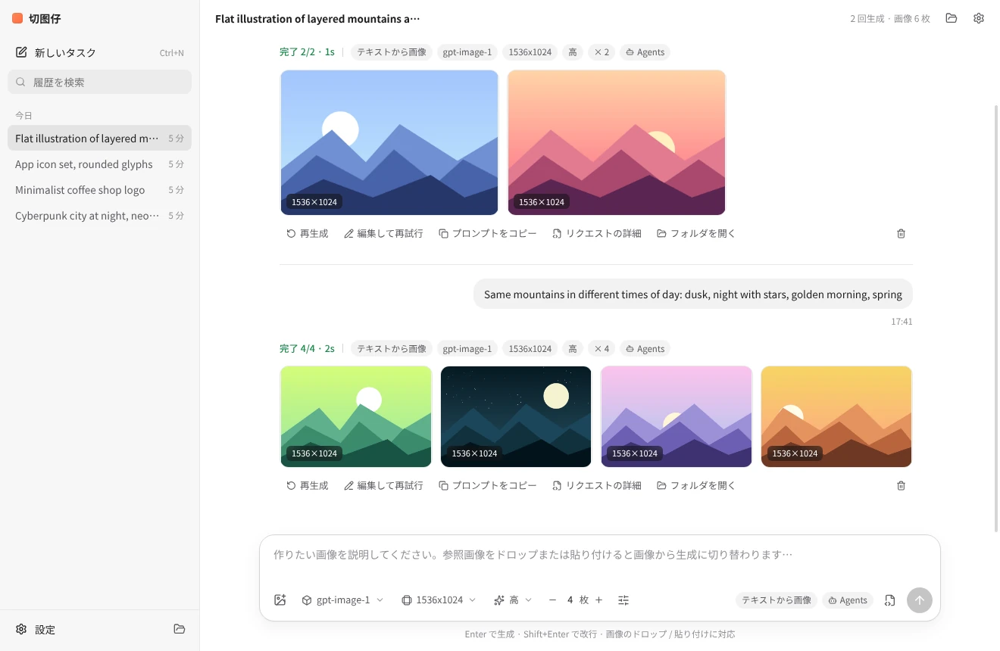

<p align="center"></p>

<h1 align="center">切图仔（Qietuzai）</h1>

<p align="center">OpenAI 互換の画像生成 API 用デスクトップアプリ。プロンプトを入力するだけで画像を生成します。<br>元になったコマンドラインスクリプト <code>img.sh</code> も同梱しています。</p>

<p align="center">
  <a href="../README.md">English</a> ·
  <a href="README.zh-CN.md">简体中文</a> ·
  <a href="README.zh-TW.md">繁體中文</a> ·
  <b>日本語</b> ·
  <a href="README.ko.md">한국어</a> ·
  <a href="README.es.md">Español</a> ·
  <a href="README.fr.md">Français</a> ·
  <a href="README.de.md">Deutsch</a> ·
  <a href="README.pt-BR.md">Português</a> ·
  <a href="README.ru.md">Русский</a>
</p>

<p align="center"></p>

## 主な機能

- **Codex 風のレイアウト**：左に履歴、右に作業エリア。生成ごとにプロンプト・参照画像・結果をまとめて表示します。
- **チャットではありません**：Enter を押すと、プロンプトがそのまま画像生成 API に送られます。
- **テキストから画像・画像から画像**：参照画像はドロップ、貼り付け、ファイル選択で追加できます。2 枚以上あるときは 1 枚をマスクに指定できます。
- **まとめて生成**：1 つのプロンプトで 1〜20 枚、または 1 行 1 プロンプトで一括生成。同時実行数の上限は全タスク共通です。
- **モデル・サイズ・品質**はリクエストごとに切り替えでき、カスタム値も使えます。
- **Agents プロンプト**：全リクエストのプロンプト先頭に追加するテキスト。共通スタイル、ブランドガイドライン、禁止事項などに。
- **サイズチェック**：すべての画像に実際のサイズを表示し、API が指定サイズを無視したときは警告します。サイズをプロンプトに書き込むこともできます。
- **dry-run**：送信前に実際のリクエストを確認できます（一括モードでは最初のプロンプトのリクエスト）。API キーは伏せ字で表示されます。
- **結果の活用**：拡大表示、コピー、フォルダで表示、名前を付けて保存、Figma や Photoshop への直接ドラッグ、参照画像としての再利用。
- **10 言語に対応**：简体中文、繁體中文、English、日本語、한국어、Español、Français、Deutsch、Português、Русский。初期設定ではシステムの言語に従います。
- **API キーはこのコンピュータに保存**され、設定した API へのリクエストにだけ使われます。キーチェーンが使える場合はキーチェーンで暗号化します。使えるキーチェーンがない場合（一部の Linux デスクトップなど）は、簡易的な暗号化のみ、または平文で、本人だけが読める設定ファイルに保存します。現在の保存方法は設定の API キー欄に表示されます。プロキシも設定できます。

## ダウンロード

[Releases](https://github.com/jerry1zhang/qietuzai/releases/latest) から最新版をダウンロードしてください。

| システム | ファイル |
| --- | --- |
| macOS（Apple シリコン、M1 以降） | `qietuzai-<バージョン>-mac-arm64.dmg` |
| macOS（Intel） | `qietuzai-<バージョン>-mac-x64.dmg` |
| Windows インストーラー | `qietuzai-<バージョン>-win-x64.exe`（ARM 版は `win-arm64.exe`） |
| Windows ポータブル版 | `qietuzai-<バージョン>-portable.exe` |
| Linux | `qietuzai-<バージョン>-linux-x86_64.AppImage` または `-linux-amd64.deb` |

アプリは Apple や Microsoft の署名を受けていないため、初回起動時にシステムに止められます。

- **macOS 15 以降**：一度アプリを開いてから、「システム設定 → プライバシーとセキュリティ」の下部にある「このまま開く」をクリックします。
- **macOS 14 以前**：アプリを右クリックして「開く」を選びます。
- ターミナルで `xattr -dr com.apple.quarantine /Applications/切图仔.app` を実行してもかまいません。
- **Windows**：SmartScreen が表示されたら「詳細情報」→「実行」をクリックします。

## はじめかた

1. **設定**を開き、API の URL（例：`https://api.openai.com/v1`）と API キーを入力して、**接続テスト**をクリックします。
2. 使うモデルを追加するか、**API から取得**をクリックして一覧から選びます。星印のモデルがデフォルトです。最後に下部の**保存**をクリックします。
3. 作業エリアに戻り、プロンプトを入力して Enter を押します。

OpenAI Images API（`/v1/images/generations` と `/v1/images/edits`）互換のサービスであれば利用できます。すでに `img.sh` を使っている場合は、**img.config から取り込む**で設定を読み込めます。

## よくある質問

**サイズや品質を変えても結果が変わらない。**
中継 API の中には `size` と `quality` パラメータを無視するものがあります（ChatGPT / Codex アカウント経由で呼び出すサービスなど）。切图仔はすべての画像に実際のサイズを表示し、一致しないものをオレンジ色で示します。**設定 → サイズをプロンプトに記載**をオンにすると、プロンプトの末尾に「出力画像のサイズは 1536x1024（横長、3:2）。」のような一文を追加します。ただしモデルはおおよそしか従わないことが多いので、正確なサイズが必要な場合はローカルで切り抜きや縮小をしてください。

**画像はどこに保存される？**
初期設定では「ピクチャ」フォルダ内の `切图仔` フォルダです。設定 → 出力で変更できます。設定と履歴はデータフォルダに保存されます（場所は設定 → このアプリについてで確認できます）。

## コマンドライン：img.sh

`img.sh` は元になったスクリプトで、bash・curl・jq が必要です（macOS と Linux で動作）。スクリプトと同じ場所に `img.config` を置きます。

```ini
url=https://api.openai.com/v1
token=sk-...
# 以下は任意
model=gpt-image-1
size=1024x1024
quality=high
count=1
```

```bash
./img.sh "雪の中の赤いキツネ"                       # 1 枚、outputs/ に保存
./img.sh -n 4 "雪の中の赤いキツネ" fox.png          # fox-1.png … fox-4.png
./img.sh -i photo.png "背景をビーチに変える"
./img.sh -i a.png -i b.png "2 枚の画像を 1 枚に合成"
./img.sh -i photo.png -m mask.png "マスク部分を星空にする"
./img.sh --dry-run "赤いキツネ"                     # リクエストを表示するだけで送信しない
```

環境変数 `IMG_MODEL`、`IMG_SIZE`、`IMG_JOBS`（同時実行数）、`IMG_CONFIG`（設定ファイルのパス）で設定を上書きできます。同名のファイルがある場合は上書きせず、`名前 (2).png` として保存します。`./img.sh --help` ですべてのオプションを表示できます（ヘルプは中国語です）。

## ソースからビルド

```bash
cd gui
npm install
npm run dev          # 開発モード（ホットリロード）
npm test             # ユニットテスト
npm run dist:mac     # または dist:win / dist:linux（それぞれの OS で実行）
```

インストーラーはそれぞれの OS 上でビルドする必要があります。`v*` タグをプッシュすると、GitHub Actions（`.github/workflows/build.yml`）が 3 つの OS 向けにビルドします。開発の詳細は [gui/README.md](../gui/README.md)（中国語）を参照してください。

UI のテキストは `gui/shared/locales/` にあり、言語ごとに 1 ファイルです。翻訳を直すときはそのファイルを編集してください。`npm test` で、すべての言語にキーとプレースホルダーがそろっているかを確認できます。
