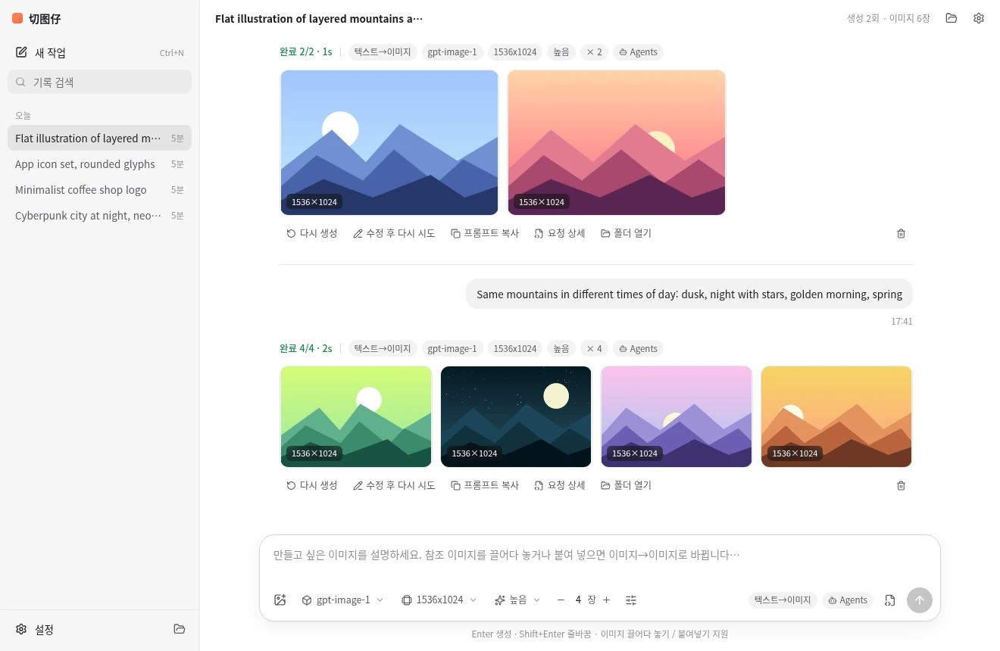

<p align="center"></p>

<h1 align="center">切图仔 (Qietuzai)</h1>

<p align="center">OpenAI 호환 이미지 생성 API용 데스크톱 앱입니다. 프롬프트를 입력하면 바로 이미지를 만듭니다.<br>앱의 출발점이 된 명령줄 스크립트 <code>img.sh</code>도 함께 들어 있습니다.</p>

<p align="center">
  <a href="../README.md">English</a> ·
  <a href="README.zh-CN.md">简体中文</a> ·
  <a href="README.zh-TW.md">繁體中文</a> ·
  <a href="README.ja.md">日本語</a> ·
  <b>한국어</b> ·
  <a href="README.es.md">Español</a> ·
  <a href="README.fr.md">Français</a> ·
  <a href="README.de.md">Deutsch</a> ·
  <a href="README.pt-BR.md">Português</a> ·
  <a href="README.ru.md">Русский</a>
</p>

<p align="center"></p>

## 기능

- **Codex 스타일 레이아웃**: 왼쪽은 기록, 오른쪽은 작업 영역입니다. 생성할 때마다 프롬프트, 참조 이미지, 결과를 한곳에 보여 줍니다.
- **채팅이 아닙니다**: Enter를 누르면 프롬프트가 바로 이미지 생성 API로 전송됩니다.
- **텍스트→이미지, 이미지→이미지**: 참조 이미지를 끌어다 놓거나 붙여 넣거나 선택하세요. 두 장 이상이면 그중 하나를 마스크로 지정할 수 있습니다.
- **일괄 생성**: 프롬프트 하나로 1–20장을 만들거나, 한 줄에 프롬프트 하나씩 일괄 생성합니다. 모든 작업이 동시 요청 수 상한을 함께 씁니다.
- **모델, 크기, 품질**을 요청마다 바꿀 수 있고 직접 입력한 값도 쓸 수 있습니다.
- **Agents 프롬프트**: 모든 요청의 프롬프트 앞에 붙는 텍스트입니다. 공통 스타일, 브랜드 가이드, 금지 사항 등에 쓰세요.
- **크기 확인**: 모든 이미지에 실제 크기를 표시하고, API가 요청한 크기를 무시하면 알려 줍니다. 크기를 프롬프트에 적어 넣을 수도 있습니다.
- **dry-run**: 보내기 전에 실제 요청을 미리 볼 수 있습니다(일괄 모드에서는 첫 번째 프롬프트의 요청). API 키는 가려서 표시합니다.
- **결과 활용**: 크게 보기, 복사, 폴더에서 보기, 다른 이름으로 저장, Figma나 Photoshop으로 바로 끌어다 놓기, 참조 이미지로 다시 쓰기.
- **10개 언어 지원**: 简体中文, 繁體中文, English, 日本語, 한국어, Español, Français, Deutsch, Português, Русский. 기본적으로 시스템 언어를 따릅니다.
- **API 키는 이 컴퓨터에 저장**되며, 설정한 API로 보내는 요청에만 쓰입니다. 키체인을 쓸 수 있으면 키체인으로 암호화합니다. 쓸 수 있는 키체인이 없으면(일부 Linux 데스크톱 등) 간단한 암호화만 하거나 평문으로, 본인만 읽을 수 있는 설정 파일에 저장합니다. 현재 저장 방식은 설정의 API 키 항목에 표시됩니다. 프록시도 설정할 수 있습니다.

## 다운로드

[Releases](https://github.com/jerry1zhang/qietuzai/releases/latest)에서 최신 버전을 받으세요.

| 시스템 | 파일 |
| --- | --- |
| macOS (Apple 실리콘, M1 이후) | `qietuzai-<버전>-mac-arm64.dmg` |
| macOS (Intel) | `qietuzai-<버전>-mac-x64.dmg` |
| Windows 설치 프로그램 | `qietuzai-<버전>-win-x64.exe` (ARM은 `win-arm64.exe`) |
| Windows 포터블 | `qietuzai-<버전>-portable.exe` |
| Linux | `qietuzai-<버전>-linux-x86_64.AppImage` 또는 `-linux-amd64.deb` |

앱이 Apple이나 Microsoft의 서명을 받지 않았기 때문에 처음 열 때 시스템이 막습니다.

- **macOS 15 이상**: 앱을 한 번 연 다음 "시스템 설정 → 개인정보 보호 및 보안" 아래쪽의 "그래도 열기"를 누르세요.
- **macOS 14 이하**: 앱을 오른쪽 클릭하고 "열기"를 선택하세요.
- 터미널에서 `xattr -dr com.apple.quarantine /Applications/切图仔.app`을 실행해도 됩니다.
- **Windows**: SmartScreen이 나타나면 "추가 정보" → "실행"을 누르세요.

## 시작하기

1. **설정**을 열고 API 주소(예: `https://api.openai.com/v1`)와 API 키를 입력한 뒤 **연결 테스트**를 누르세요.
2. 사용할 모델을 추가하거나 **API에서 가져오기**를 눌러 목록에서 고르세요. 별표가 붙은 모델이 기본 모델입니다. 그다음 아래쪽의 **저장**을 누르세요.
3. 작업 영역으로 돌아가 프롬프트를 입력하고 Enter를 누르세요.

OpenAI Images API(`/v1/images/generations`, `/v1/images/edits`)와 호환되는 서비스라면 모두 쓸 수 있습니다. 이미 `img.sh`를 쓰고 있다면 **img.config 가져오기**로 설정을 채울 수 있습니다.

## 자주 묻는 질문

**크기나 품질을 바꿔도 결과가 그대로예요.**
일부 중계 API는 `size`와 `quality` 매개변수를 무시합니다(ChatGPT / Codex 계정을 통해 호출하는 서비스 등). 切图仔는 모든 이미지의 실제 크기를 표시하고, 맞지 않는 이미지는 주황색으로 표시합니다. **설정 → 크기를 프롬프트에 기록**을 켜면 프롬프트 끝에 "출력 이미지 크기: 1536x1024 (가로, 3:2)." 같은 문장이 붙습니다. 다만 모델은 대략적으로만 따르는 경우가 많으니, 정확한 크기가 필요하면 로컬에서 자르거나 크기를 조정하세요.

**이미지는 어디에 저장되나요?**
기본값은 "사진(Pictures)" 폴더 안의 `切图仔` 폴더이며, 설정 → 출력에서 바꿀 수 있습니다. 설정과 기록은 데이터 폴더에 저장되며 위치는 설정 → 정보에서 확인할 수 있습니다.

## 명령줄: img.sh

`img.sh`는 앱의 출발점이 된 스크립트로 bash, curl, jq가 필요합니다(macOS와 Linux에서 실행). 스크립트 옆에 `img.config`를 두세요.

```ini
url=https://api.openai.com/v1
token=sk-...
# 아래는 선택 사항
model=gpt-image-1
size=1024x1024
quality=high
count=1
```

```bash
./img.sh "눈밭의 붉은 여우"                         # 1장, outputs/에 저장
./img.sh -n 4 "눈밭의 붉은 여우" fox.png            # fox-1.png … fox-4.png
./img.sh -i photo.png "배경을 해변으로 바꾸기"
./img.sh -i a.png -i b.png "두 이미지를 하나로 합치기"
./img.sh -i photo.png -m mask.png "마스크 영역을 별이 빛나는 하늘로"
./img.sh --dry-run "붉은 여우"                      # 요청만 출력하고 보내지 않음
```

환경 변수 `IMG_MODEL`, `IMG_SIZE`, `IMG_JOBS`(동시 요청 수), `IMG_CONFIG`(설정 파일 경로)로 설정을 덮어쓸 수 있습니다. 같은 이름의 파일이 있으면 덮어쓰지 않고 `이름 (2).png`로 저장합니다. `./img.sh --help`로 모든 옵션을 볼 수 있습니다(도움말은 중국어).

## 소스에서 빌드하기

```bash
cd gui
npm install
npm run dev          # 개발 모드(핫 리로드)
npm test             # 단위 테스트
npm run dist:mac     # 또는 dist:win / dist:linux, 해당 OS에서 실행
```

설치 파일은 각 OS에서 빌드해야 합니다. `v*` 태그를 푸시하면 GitHub Actions(`.github/workflows/build.yml`)가 세 OS용을 모두 빌드합니다. 개발 관련 자세한 내용은 [gui/README.md](../gui/README.md)(중국어)를 참고하세요.

UI 텍스트는 `gui/shared/locales/`에 언어별로 한 파일씩 있습니다. 번역을 고치려면 해당 파일을 수정하세요. `npm test`가 모든 언어에 키와 자리표시자가 빠짐없이 있는지 확인합니다.
