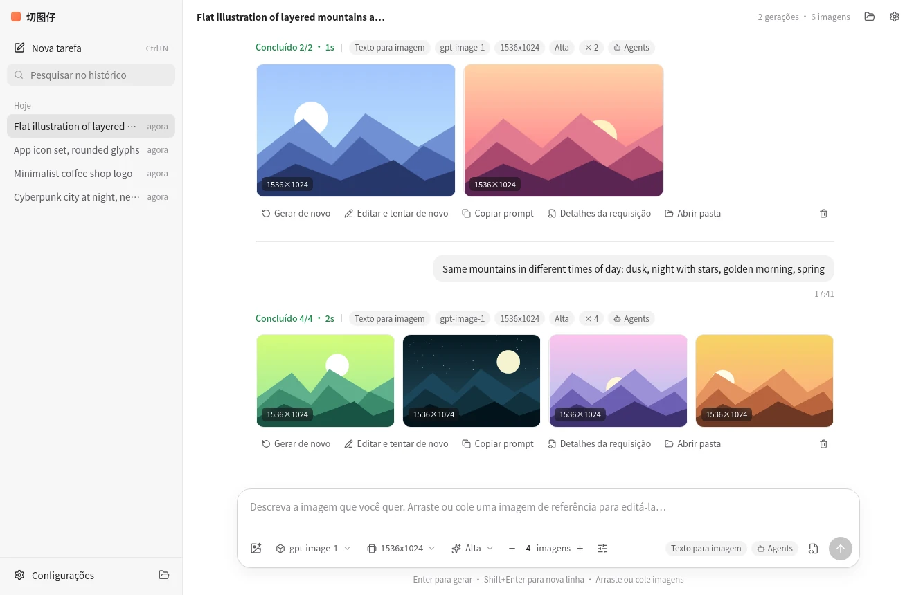

<p align="center"></p>

<h1 align="center">切图仔 · Qietuzai</h1>

<p align="center">Um app de desktop para APIs de geração de imagens compatíveis com a OpenAI. Digite um prompt e receba imagens.<br>Inclui o <code>img.sh</code>, o script de linha de comando que deu origem ao app.</p>

<p align="center">
  <a href="../README.md">English</a> ·
  <a href="README.zh-CN.md">简体中文</a> ·
  <a href="README.zh-TW.md">繁體中文</a> ·
  <a href="README.ja.md">日本語</a> ·
  <a href="README.ko.md">한국어</a> ·
  <a href="README.es.md">Español</a> ·
  <a href="README.fr.md">Français</a> ·
  <a href="README.de.md">Deutsch</a> ·
  <b>Português</b> ·
  <a href="README.ru.md">Русский</a>
</p>

<p align="center"></p>

## Recursos

- **Layout no estilo do Codex.** O histórico fica à esquerda e a área de trabalho à direita. Cada geração mostra junto o prompt, as imagens de referência e os resultados.
- **Não é um chat.** Ao apertar Enter, o prompt vai direto para a API de imagens.
- **Texto para imagem e imagem para imagem.** Arraste, cole ou escolha imagens de referência. Com duas ou mais, dá para marcar uma como máscara.
- **Lotes.** Gere de 1 a 20 imagens por prompt, ou ative um prompt por linha. Todas as tarefas compartilham o mesmo limite de requisições simultâneas.
- **Troque modelo, tamanho e qualidade** a cada requisição. Valores personalizados também são aceitos.
- **Prompt de Agents.** Um texto adicionado ao início de toda requisição: estilo comum, diretrizes de marca, coisas a evitar…
- **Verificação de tamanho.** Toda imagem mostra seu tamanho real. O app avisa quando a API ignorou o tamanho pedido e também pode escrever o tamanho no prompt.
- **Dry run.** Veja a requisição exata antes de enviar (no modo lote, a do primeiro prompt). A chave de API aparece mascarada.
- **Use os resultados.** Veja em tamanho grande, copie, mostre na pasta, salve uma cópia, arraste para o Figma ou o Photoshop, ou use uma imagem como referência.
- **10 idiomas:** 简体中文, 繁體中文, English, 日本語, 한국어, Español, Français, Deutsch, Português, Русский. Por padrão, segue o idioma do sistema.
- **A chave de API fica salva no seu computador** e só é enviada para a API que você configurar. Ela é criptografada com o chaveiro do sistema quando há um disponível. Sem um chaveiro utilizável (por exemplo, em alguns desktops Linux), ela tem só criptografia básica ou fica em texto simples, em um arquivo de configurações que só você pode ler. O campo da chave nas Configurações mostra qual é o caso. O proxy é opcional.

## Download

Baixe a versão mais recente em [Releases](https://github.com/jerry1zhang/qietuzai/releases/latest):

| Sistema | Arquivo |
| --- | --- |
| macOS, Apple Silicon (M1 ou mais recente) | `qietuzai-<versão>-mac-arm64.dmg` |
| macOS, Intel | `qietuzai-<versão>-mac-x64.dmg` |
| Instalador do Windows | `qietuzai-<versão>-win-x64.exe` (ARM: `win-arm64.exe`) |
| Windows portátil | `qietuzai-<versão>-portable.exe` |
| Linux | `qietuzai-<versão>-linux-x86_64.AppImage` ou `-linux-amd64.deb` |

O app não é assinado pela Apple nem pela Microsoft, então o sistema mostra um aviso na primeira vez que você o abre:

- **macOS 15 ou mais recente:** abra o app uma vez, depois vá em Ajustes do Sistema → Privacidade e Segurança e clique em "Abrir Mesmo Assim" no fim da página.
- **macOS 14 ou anterior:** clique com o botão direito no app e escolha Abrir.
- No macOS, também dá para rodar `xattr -dr com.apple.quarantine /Applications/切图仔.app` no Terminal.
- **Windows:** se o SmartScreen aparecer, clique em "Mais informações" e depois em "Executar assim mesmo".

## Primeiros passos

1. Abra as **Configurações**. Preencha a URL da API (por exemplo `https://api.openai.com/v1`) e sua chave de API, e clique em **Testar conexão**.
2. Adicione os modelos que você usa, ou clique em **Buscar na API** e escolha na lista. O modelo com estrela é o padrão. Depois clique em **Salvar** na barra inferior.
3. Volte à área de trabalho, digite um prompt e aperte Enter.

Qualquer serviço compatível com a OpenAI Images API funciona (`/v1/images/generations` e `/v1/images/edits`). Se você já usa o `img.sh`, clique em **Importar img.config** para preencher as configurações.

## Perguntas frequentes

**Mudar o tamanho ou a qualidade não faz efeito.**
Alguns serviços intermediários ignoram os parâmetros `size` e `quality`, por exemplo os que passam as requisições por contas do ChatGPT ou do Codex. O 切图仔 mostra o tamanho real de cada imagem e destaca as que não batem. Você pode ativar **Configurações → Escrever o tamanho no prompt**, que adiciona ao prompt uma frase como "Tamanho da imagem de saída: 1536x1024 (paisagem, 3:2).". Os modelos costumam seguir isso só aproximadamente; se precisar de um tamanho exato, recorte ou redimensione localmente.

**Onde as imagens são salvas?**
Por padrão, na pasta `切图仔` dentro da sua pasta Imagens. Dá para mudar em Configurações → Saída. As configurações e o histórico ficam na pasta de dados mostrada em Configurações → Sobre.

## Linha de comando: img.sh

O `img.sh` é o script original. Ele precisa de bash, curl e jq, então roda no macOS e no Linux. Coloque um `img.config` ao lado dele:

```ini
url=https://api.openai.com/v1
token=sk-...
# opcional
model=gpt-image-1
size=1024x1024
quality=high
count=1
```

```bash
./img.sh "uma raposa vermelha na neve"                # 1 imagem, salva em outputs/
./img.sh -n 4 "uma raposa vermelha na neve" fox.png   # fox-1.png … fox-4.png
./img.sh -i foto.png "troque o fundo por uma praia"
./img.sh -i a.png -i b.png "junte as duas imagens"
./img.sh -i foto.png -m mascara.png "preencha a área da máscara com estrelas"
./img.sh --dry-run "uma raposa vermelha"              # mostra a requisição sem enviar
```

Estas variáveis de ambiente substituem a configuração: `IMG_MODEL`, `IMG_SIZE`, `IMG_JOBS` (requisições simultâneas) e `IMG_CONFIG` (caminho do arquivo de configuração). Um arquivo existente nunca é sobrescrito; o novo é salvo como `nome (2).png`. Rode `./img.sh --help` para ver todas as opções (a ajuda está em chinês).

## Compilar a partir do código-fonte

```bash
cd gui
npm install
npm run dev          # modo de desenvolvimento com hot reload
npm test             # testes unitários
npm run dist:mac     # ou dist:win / dist:linux, no sistema correspondente
```

Cada instalador precisa ser gerado no próprio sistema. Ao enviar uma tag `v*`, o GitHub Actions (`.github/workflows/build.yml`) gera os três. Mais detalhes em [gui/README.md](../gui/README.md) (em chinês).

Os textos da interface ficam em `gui/shared/locales/`, um arquivo por idioma. Para corrigir uma tradução, edite esse arquivo. O `npm test` verifica se todos os idiomas têm todas as chaves e marcadores.
