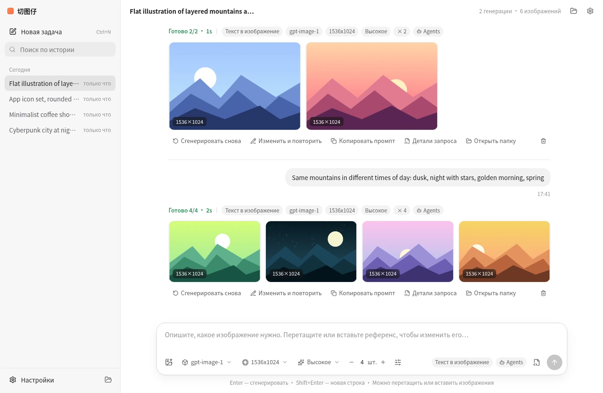

<p align="center"></p>

<h1 align="center">切图仔 · Qietuzai</h1>

<p align="center">Настольное приложение для API генерации изображений, совместимых с OpenAI. Введите промпт и получите изображения.<br>В комплекте есть <code>img.sh</code> — скрипт командной строки, с которого всё началось.</p>

<p align="center">
  <a href="../README.md">English</a> ·
  <a href="README.zh-CN.md">简体中文</a> ·
  <a href="README.zh-TW.md">繁體中文</a> ·
  <a href="README.ja.md">日本語</a> ·
  <a href="README.ko.md">한국어</a> ·
  <a href="README.es.md">Español</a> ·
  <a href="README.fr.md">Français</a> ·
  <a href="README.de.md">Deutsch</a> ·
  <a href="README.pt-BR.md">Português</a> ·
  <b>Русский</b>
</p>

<p align="center"></p>

## Возможности

- **Интерфейс в стиле Codex.** Слева история, справа рабочая область. Для каждой генерации промпт, референсы и результаты показаны вместе.
- **Это не чат.** Нажмите Enter, и промпт сразу уйдёт в API изображений.
- **Текст в изображение и изображение в изображение.** Перетащите, вставьте или выберите референсы. Если их два и больше, один можно сделать маской.
- **Пакетная генерация.** От 1 до 20 изображений на промпт или по одному промпту в строке. Все задачи делят общий лимит параллельных запросов.
- **Модель, размер и качество** можно менять для каждого запроса, в том числе на свои значения.
- **Промпт Agents.** Текст, который добавляется в начало каждого запроса: общий стиль, правила бренда, запреты и т. п.
- **Проверка размера.** У каждого изображения показан фактический размер. Приложение предупреждает, если API проигнорировал запрошенный размер, и может дописать размер в промпт.
- **Dry run.** Посмотрите точный запрос перед отправкой (в пакетном режиме — запрос для первого промпта). Ключ API скрыт.
- **Работа с результатами.** Просмотр в полном размере, копирование, показ в папке, сохранение копии, перетаскивание в Figma или Photoshop, использование как референса.
- **10 языков:** 简体中文, 繁體中文, English, 日本語, 한국어, Español, Français, Deutsch, Português, Русский. По умолчанию используется язык системы.
- **Ключ API хранится на вашем компьютере** и отправляется только в указанный вами API. Если доступна системная связка ключей, ключ шифруется ею. Без неё (например, в некоторых средах Linux) ключ шифруется лишь простым способом или хранится открытым текстом в файле настроек, доступном только вам. Поле ключа API в настройках показывает, какой вариант используется. Прокси — по желанию.

## Скачать

Последняя версия — на странице [Releases](https://github.com/jerry1zhang/qietuzai/releases/latest):

| Система | Файл |
| --- | --- |
| macOS, Apple Silicon (M1 и новее) | `qietuzai-<версия>-mac-arm64.dmg` |
| macOS, Intel | `qietuzai-<версия>-mac-x64.dmg` |
| Установщик для Windows | `qietuzai-<версия>-win-x64.exe` (ARM: `win-arm64.exe`) |
| Портативная версия для Windows | `qietuzai-<версия>-portable.exe` |
| Linux | `qietuzai-<версия>-linux-x86_64.AppImage` или `-linux-amd64.deb` |

Приложение не подписано Apple и Microsoft, поэтому при первом запуске система покажет предупреждение:

- **macOS 15 и новее:** откройте приложение один раз, затем в «Системных настройках → Конфиденциальность и безопасность» нажмите внизу «Всё равно открыть».
- **macOS 14 и старше:** нажмите на приложение правой кнопкой мыши и выберите «Открыть».
- В macOS можно также выполнить в Терминале `xattr -dr com.apple.quarantine /Applications/切图仔.app`.
- **Windows:** если появится SmartScreen, нажмите «Подробнее», затем «Выполнить в любом случае».

## Начало работы

1. Откройте **Настройки**. Укажите URL API (например, `https://api.openai.com/v1`) и ключ API, затем нажмите **Проверить подключение**.
2. Добавьте нужные модели или нажмите **Получить из API** и выберите их из списка. Модель со звёздочкой используется по умолчанию. Затем нажмите **Сохранить** на панели внизу.
3. Вернитесь в рабочую область, введите промпт и нажмите Enter.

Подходит любой сервис, совместимый с OpenAI Images API (`/v1/images/generations` и `/v1/images/edits`). Если вы уже пользуетесь `img.sh`, нажмите **Импорт из img.config**, чтобы заполнить настройки.

## Частые вопросы

**Изменение размера или качества ни на что не влияет.**
Некоторые промежуточные сервисы игнорируют параметры `size` и `quality` — например, те, что проводят запросы через аккаунты ChatGPT или Codex. 切图仔 показывает фактический размер каждого изображения и помечает несовпадения. Можно включить **Настройки → Писать размер в промпт**: в конец промпта добавится фраза вроде «Размер выходного изображения: 1536x1024 (горизонтальное, 3:2).». Модели обычно следуют ей лишь приблизительно, поэтому для точного размера обрежьте или масштабируйте изображение локально.

**Куда сохраняются изображения?**
По умолчанию в папку `切图仔` внутри папки «Изображения». Это можно изменить в разделе Настройки → Вывод. Настройки и история хранятся в папке данных, путь к которой указан в разделе Настройки → О программе.

## Командная строка: img.sh

`img.sh` — исходный скрипт. Ему нужны bash, curl и jq, поэтому он работает в macOS и Linux. Положите рядом с ним файл `img.config`:

```ini
url=https://api.openai.com/v1
token=sk-...
# необязательно
model=gpt-image-1
size=1024x1024
quality=high
count=1
```

```bash
./img.sh "рыжая лиса на снегу"                   # 1 изображение, сохраняется в outputs/
./img.sh -n 4 "рыжая лиса на снегу" fox.png      # fox-1.png … fox-4.png
./img.sh -i photo.png "замени фон на пляж"
./img.sh -i a.png -i b.png "объедини два изображения"
./img.sh -i photo.png -m mask.png "заполни область маски звёздами"
./img.sh --dry-run "рыжая лиса"                  # показать запрос, не отправляя его
```

Эти переменные окружения переопределяют конфигурацию: `IMG_MODEL`, `IMG_SIZE`, `IMG_JOBS` (параллельные запросы) и `IMG_CONFIG` (путь к файлу конфигурации). Существующие файлы не перезаписываются: новый сохраняется как `имя (2).png`. `./img.sh --help` покажет все параметры (справка на китайском).

## Сборка из исходного кода

```bash
cd gui
npm install
npm run dev          # режим разработки с горячей перезагрузкой
npm test             # модульные тесты
npm run dist:mac     # или dist:win / dist:linux — в соответствующей системе
```

Каждый установщик собирается в своей системе. После пуша тега `v*` GitHub Actions (`.github/workflows/build.yml`) собирает все три. Подробнее — в [gui/README.md](../gui/README.md) (на китайском).

Тексты интерфейса лежат в `gui/shared/locales/`, по одному файлу на язык. Чтобы исправить перевод, отредактируйте этот файл. `npm test` проверяет, что во всех языках есть все ключи и плейсхолдеры.
