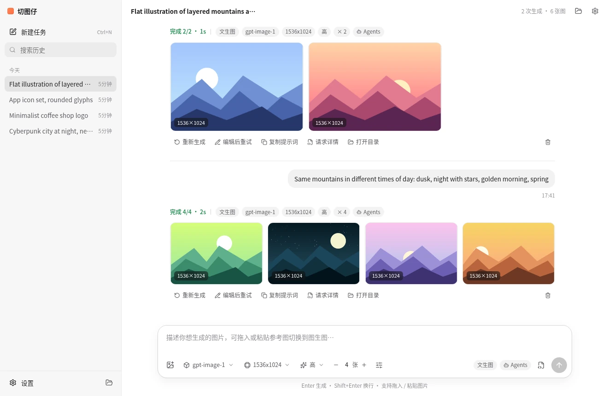

<p align="center"></p>

<h1 align="center">切图仔</h1>

<p align="center">兼容 OpenAI 生图接口的桌面应用：输入提示词，直接出图。<br>附带最初的命令行脚本 <code>img.sh</code>。</p>

<p align="center">
  <a href="../README.md">English</a> ·
  <b>简体中文</b> ·
  <a href="README.zh-TW.md">繁體中文</a> ·
  <a href="README.ja.md">日本語</a> ·
  <a href="README.ko.md">한국어</a> ·
  <a href="README.es.md">Español</a> ·
  <a href="README.fr.md">Français</a> ·
  <a href="README.de.md">Deutsch</a> ·
  <a href="README.pt-BR.md">Português</a> ·
  <a href="README.ru.md">Русский</a>
</p>

<p align="center"></p>

## 功能

- **类 Codex 布局**：左边是历史任务，右边是工作区。每次生成的提示词、参考图和结果放在一起。
- **不是聊天**：回车后提示词直接发给生图接口。
- **文生图、图生图**：拖入、粘贴或选择参考图即可。参考图有两张以上时，可以把其中一张设为蒙版。
- **批量生成**：同一提示词一次生成 1–20 张，也可以每行一个提示词。所有任务共用一个并发上限。
- **模型、尺寸、质量**每次都可以切换，也可以填自定义值。
- **Agents 提示词**：每次请求都会加在提示词最前面，适合放统一的风格、品牌规范、禁止项。
- **尺寸检查**：每张图都标出实际尺寸。接口没按要求的尺寸出图时会提醒，也可以把尺寸写进提示词。
- **预览请求（dry-run）**：发送前查看实际请求（批量模式下显示第一条提示词的请求），API Key 打码显示。
- **结果图**：可以看大图、复制、在文件夹中显示、另存为、直接拖进 Figma 或 PS，也可以作为参考图继续改。
- **10 种界面语言**：简体中文、繁體中文、English、日本語、한국어、Español、Français、Deutsch、Português、Русский，默认跟随系统。
- **API Key 保存在本机**，只会随请求发给你配置的接口。系统有钥匙串时用钥匙串加密；没有可用的钥匙串时（比如部分 Linux 桌面），只做简单加密或以明文保存在仅当前用户可读的设置文件里。设置页 API Key 一栏会显示当前的保存方式。可选代理。

## 下载

在 [Releases](https://github.com/jerry1zhang/qietuzai/releases/latest) 页面下载最新版：

| 系统 | 文件 |
| --- | --- |
| macOS（Apple 芯片，M1 及以后） | `qietuzai-<版本>-mac-arm64.dmg` |
| macOS（Intel 芯片） | `qietuzai-<版本>-mac-x64.dmg` |
| Windows 安装版 | `qietuzai-<版本>-win-x64.exe`（ARM 设备用 `win-arm64.exe`） |
| Windows 免安装版 | `qietuzai-<版本>-portable.exe` |
| Linux | `qietuzai-<版本>-linux-x86_64.AppImage` 或 `-linux-amd64.deb` |

应用没有经过 Apple 和微软的签名认证，第一次打开时系统会拦一下：

- **macOS 15 及以上**：先双击打开一次，再到「系统设置 → 隐私与安全性」页面底部点「仍要打开」。
- **macOS 14 及以下**：右键点应用，选「打开」。
- 也可以在终端执行 `xattr -dr com.apple.quarantine /Applications/切图仔.app`。
- **Windows**：如果弹出 SmartScreen 提示，点「更多信息」→「仍要运行」。

## 快速上手

1. 打开**设置**，填好接口地址（例如 `https://api.openai.com/v1`）和 API Key，点**测试连接**。
2. 添加要用的模型，或者点**从接口获取**，在列表里点选。带星标的是默认模型。然后点底部的**保存**。
3. 回到工作区，输入提示词，按回车。

兼容 OpenAI Images API（`/v1/images/generations` 和 `/v1/images/edits`）的服务都能用。已经在用 `img.sh` 的话，点**从 img.config 导入**就能填好设置。

## 常见问题

**改了尺寸或质量，生成的图没变化。**
有些中转接口会忽略 `size` 和 `quality` 参数，比如用 ChatGPT / Codex 账号池代调的渠道。切图仔会标出每张图的实际尺寸，对不上的会标成橙色。可以在**设置 → 把尺寸写进提示词**里打开，提示词末尾会加上「输出图片尺寸为 1536x1024（横版，3:2）。」这样的描述。不过模型通常只能大致照做，需要精确尺寸的话请在本地裁剪或缩放。

**图片保存在哪里？**
默认在系统「图片」文件夹下的 `切图仔` 目录，可以在设置 → 输出里修改。设置和历史记录保存在数据目录，位置见设置 → 关于。

## 命令行：img.sh

`img.sh` 是最初的脚本，需要 bash、curl 和 jq，可以在 macOS 和 Linux 上运行。在脚本旁边放一个 `img.config`：

```ini
url=https://api.openai.com/v1
token=sk-...
# 以下可选
model=gpt-image-1
size=1024x1024
quality=high
count=1
```

```bash
./img.sh "雪地里的红狐狸"                          # 1 张，保存到 outputs/
./img.sh -n 4 "雪地里的红狐狸" fox.png             # 生成 fox-1.png … fox-4.png
./img.sh -i 原图.png "把背景换成海滩"
./img.sh -i a.png -i b.png "把两张图合成一张"
./img.sh -i 原图.png -m 蒙版.png "把蒙版区域换成星空"
./img.sh --dry-run "红狐狸"                        # 只打印请求，不发送
```

可以用环境变量覆盖配置：`IMG_MODEL`、`IMG_SIZE`、`IMG_JOBS`（并发数）、`IMG_CONFIG`（配置文件路径）。输出文件已存在时不会覆盖，会存成 `名字 (2).png`。`./img.sh --help` 可以看全部用法。

## 从源码构建

```bash
cd gui
npm install
npm run dev          # 开发模式，热更新
npm test             # 单元测试
npm run dist:mac     # 或 dist:win / dist:linux，要在对应系统上执行
```

各平台的安装包要在对应系统上打。推送 `v*` tag 后，GitHub Actions（`.github/workflows/build.yml`）会把三个平台都打好。更多开发说明见 [gui/README.md](../gui/README.md)。

界面文字在 `gui/shared/locales/` 下，每种语言一个文件，改翻译直接改对应文件就行。`npm test` 会检查每种语言的键和占位符是否齐全。
