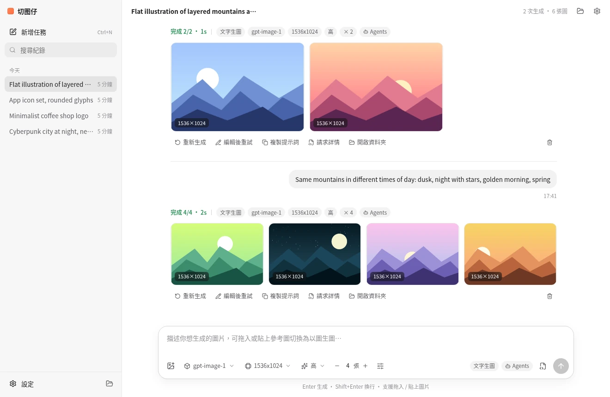

<p align="center"></p>

<h1 align="center">切图仔</h1>

<p align="center">相容 OpenAI 生圖 API 的桌面應用程式：輸入提示詞，直接出圖。<br>附帶最初的命令列腳本 <code>img.sh</code>。</p>

<p align="center">
  <a href="../README.md">English</a> ·
  <a href="README.zh-CN.md">简体中文</a> ·
  <b>繁體中文</b> ·
  <a href="README.ja.md">日本語</a> ·
  <a href="README.ko.md">한국어</a> ·
  <a href="README.es.md">Español</a> ·
  <a href="README.fr.md">Français</a> ·
  <a href="README.de.md">Deutsch</a> ·
  <a href="README.pt-BR.md">Português</a> ·
  <a href="README.ru.md">Русский</a>
</p>

<p align="center"></p>

## 功能

- **類 Codex 版面**：左邊是歷史任務，右邊是工作區。每次生成的提示詞、參考圖和結果放在一起。
- **不是聊天**：按 Enter 後提示詞直接送到生圖 API。
- **文字生圖、以圖生圖**：拖入、貼上或選擇參考圖即可。參考圖有兩張以上時，可以把其中一張設為遮罩。
- **批次生成**：同一提示詞一次生成 1–20 張，也可以每行一個提示詞。所有任務共用一個並行上限。
- **模型、尺寸、品質**每次都可以切換，也可以填自訂值。
- **Agents 提示詞**：每次請求都會加在提示詞最前面，適合放統一的風格、品牌規範、禁止事項。
- **尺寸檢查**：每張圖都標出實際尺寸。API 沒有照要求的尺寸出圖時會提醒，也可以把尺寸寫進提示詞。
- **預覽請求（dry-run）**：傳送前查看實際請求（批次模式下顯示第一個提示詞的請求），API Key 會遮蔽顯示。
- **結果圖**：可以看大圖、複製、在資料夾中顯示、另存新檔、直接拖進 Figma 或 Photoshop，也可以作為參考圖繼續修改。
- **10 種介面語言**：简体中文、繁體中文、English、日本語、한국어、Español、Français、Deutsch、Português、Русский，預設跟隨系統。
- **API Key 儲存在本機**，只會隨請求傳送給你設定的 API。系統有鑰匙圈時用鑰匙圈加密；沒有可用的鑰匙圈時（例如部分 Linux 桌面），只做簡單加密或以明文儲存在僅限目前使用者讀取的設定檔中。設定頁 API Key 一欄會顯示目前的儲存方式。可選用代理伺服器。

## 下載

在 [Releases](https://github.com/jerry1zhang/qietuzai/releases/latest) 頁面下載最新版：

| 系統 | 檔案 |
| --- | --- |
| macOS（Apple 晶片，M1 及之後） | `qietuzai-<版本>-mac-arm64.dmg` |
| macOS（Intel 晶片） | `qietuzai-<版本>-mac-x64.dmg` |
| Windows 安裝版 | `qietuzai-<版本>-win-x64.exe`（ARM 裝置用 `win-arm64.exe`） |
| Windows 免安裝版 | `qietuzai-<版本>-portable.exe` |
| Linux | `qietuzai-<版本>-linux-x86_64.AppImage` 或 `-linux-amd64.deb` |

應用程式沒有經過 Apple 和微軟的簽章認證，第一次開啟時系統會攔下：

- **macOS 15 及以上**：先開啟一次，再到「系統設定 → 隱私權與安全性」頁面底部點「強制打開」。
- **macOS 14 及以下**：在應用程式上按右鍵，選「打開」。
- 也可以在終端機執行 `xattr -dr com.apple.quarantine /Applications/切图仔.app`。
- **Windows**：如果跳出 SmartScreen 提示，點「其他資訊」→「仍要執行」。

## 快速上手

1. 開啟**設定**，填好 API 位址（例如 `https://api.openai.com/v1`）和 API Key，點**測試連線**。
2. 新增要用的模型，或點**從 API 取得**，在清單中點選。有星號的是預設模型。然後點底部的**儲存**。
3. 回到工作區，輸入提示詞，按 Enter。

相容 OpenAI Images API（`/v1/images/generations` 和 `/v1/images/edits`）的服務都能使用。已經在用 `img.sh` 的話，點**從 img.config 匯入**就能填好設定。

## 常見問題

**改了尺寸或品質，生成的圖沒有變化。**
有些中繼 API 會忽略 `size` 和 `quality` 參數，例如透過 ChatGPT / Codex 帳號池代為呼叫的管道。切图仔會標出每張圖的實際尺寸，不一致的會標成橘色。可以在**設定 → 把尺寸寫進提示詞**中開啟，提示詞結尾會加上「輸出圖片尺寸為 1536x1024（橫向，3:2）。」這樣的描述。不過模型通常只能大致照做，需要精確尺寸的話請在本機裁切或縮放。

**圖片儲存在哪裡？**
預設在系統「圖片」資料夾下的 `切图仔` 資料夾，可以在設定 → 輸出中修改。設定和歷史紀錄儲存在資料資料夾，位置見設定 → 關於。

## 命令列：img.sh

`img.sh` 是最初的腳本，需要 bash、curl 和 jq，可以在 macOS 和 Linux 上執行。在腳本旁邊放一個 `img.config`：

```ini
url=https://api.openai.com/v1
token=sk-...
# 以下為選填
model=gpt-image-1
size=1024x1024
quality=high
count=1
```

```bash
./img.sh "雪地裡的紅狐狸"                          # 1 張，儲存到 outputs/
./img.sh -n 4 "雪地裡的紅狐狸" fox.png             # 生成 fox-1.png … fox-4.png
./img.sh -i 原圖.png "把背景換成海灘"
./img.sh -i a.png -i b.png "把兩張圖合成一張"
./img.sh -i 原圖.png -m 遮罩.png "把遮罩區域換成星空"
./img.sh --dry-run "紅狐狸"                        # 只印出請求，不傳送
```

可以用環境變數覆蓋設定：`IMG_MODEL`、`IMG_SIZE`、`IMG_JOBS`（並行數）、`IMG_CONFIG`（設定檔路徑）。輸出檔案已存在時不會覆蓋，會存成 `名稱 (2).png`。`./img.sh --help` 可以看全部用法（說明文字為簡體中文）。

## 從原始碼建置

```bash
cd gui
npm install
npm run dev          # 開發模式，熱更新
npm test             # 單元測試
npm run dist:mac     # 或 dist:win / dist:linux，要在對應的系統上執行
```

各平台的安裝檔要在對應的系統上打包。推送 `v*` tag 後，GitHub Actions（`.github/workflows/build.yml`）會把三個平台都打包好。更多開發說明見 [gui/README.md](../gui/README.md)（簡體中文）。

介面文字在 `gui/shared/locales/` 下，每種語言一個檔案，修改翻譯直接改對應的檔案即可。`npm test` 會檢查每種語言的鍵和佔位符是否齊全。
